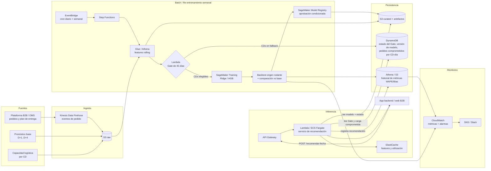

# Arquitectura en AWS

Esta es la propuesta para poner en producción la solución del desafío: corregir el pronóstico de demanda de cada centro de distribución (CD) y recomendar la mejor fecha de despacho cuando el cliente hace su pedido.

La idea central es que **el sistema siempre responde**. Si un CD no tiene suficiente historia o el modelo falla, se usa el pronóstico base en lugar de dar un error.

## Diagrama

## Cómo fluye todo

1. Los pedidos, los pronósticos y la capacidad llegan a S3 en crudo, particionados por fecha y por CD.
2. Cada madrugada, Step Functions calcula las features y pasa por el Gate.
3. Los CDs con historia suficiente usan el modelo vigente del Model Registry. El resto queda en *fallback* con el pronóstico base.
4. La app llama al endpoint, que combina el pronóstico corregido con la carga ya comprometida y devuelve las fechas ordenadas de menor a mayor utilización.
5. Cada semana se reentrena el modelo, se compara contra el base en backtest y solo se promueve si mejora.
6. Las métricas se guardan y disparan alertas si el sesgo se desvía.

## Componentes

### Ingesta

| Componente | Qué hace | Por qué |
|---|---|---|
| Kinesis Firehose → S3 raw | Recibe los eventos de pedido y los archivos de pronóstico y capacidad. | Separa la plataforma transaccional de la analítica. Es barato y deja un historial inmutable que se puede reproducir. |

### Batch y reentrenamiento

| Componente | Qué hace | Por qué |
|---|---|---|
| EventBridge + Step Functions | Orquestan el pipeline diario (features, Gate, inferencia por lote) y el semanal (reentrenamiento y backtest). | Dan reintentos, trazabilidad y una bifurcación explícita según el Gate. |
| Glue / Athena | Construyen las features rolling y las tablas curadas, usando solo datos conocidos hasta la fecha de corte. | Es SQL serverless: no hay clústeres que operar con 6 CDs, y escala si crecen. |
| Lambda del Gate | Cuenta los días continuos de historia por CD y decide `TRAIN` o `FALLBACK`. Guarda el estado en DynamoDB. | Es lógica pequeña, determinista y auditable. Es la única puerta de entrada al entrenamiento. |
| SageMaker Training + Model Registry | Entrena con los CDs elegibles. Solo promueve el modelo si su WAPE en backtest es menor que el del base y no empeora ningún CD. | Es un esquema *champion/challenger* con aprobación condicionada, para no promover regresiones. |

### Inferencia

| Componente | Qué hace | Por qué |
|---|---|---|
| API Gateway + Lambda (o Fargate) | Expone `POST /recomendar-fecha`: recibe el CD y el pedido, y devuelve fechas candidatas ordenadas por utilización proyectada. | Un Ridge pesa kilobytes y se evalúa en milisegundos, así que Lambda alcanza. Un endpoint de SageMaker solo haría falta con un modelo pesado. Meta: p95 menor a 200 ms. |
| ElastiCache | Guarda en caché las features y la carga comprometida por CD y día. | Evita consultar Athena o S3 en el camino crítico. |

### Persistencia

| Componente | Qué guarda | Por qué |
|---|---|---|
| S3 curated | Datos de entrenamiento, modelos versionados y predicciones batch. | Es la fuente de verdad y se puede auditar. |
| DynamoDB | Estado del Gate por CD, versión del modelo activo y carga comprometida. | Lecturas en milisegundos para la ruta de recomendación. |
| Athena sobre S3 | Historial de WAPE y Bias por CD y horizonte, recomendaciones emitidas y su aceptación. | Permite analizar el historial y detectar deriva sin montar otro servidor. |

### Observabilidad

| Componente | Qué hace | Por qué |
|---|---|---|
| CloudWatch + SNS | Alarmas por: Bias móvil de 7 días fuera de rango, WAPE peor que el base, cambio de estado del Gate y datos faltantes o desactualizados. | Cierra el ciclo: si el sesgo se desvía, se reentrena o se cae a *fallback* automáticamente. |

## El Gate de historia mínima

Cuenta los **días consecutivos con dato que terminan ayer**. Un hueco reinicia la cuenta, y una serie desactualizada cuenta como cero.

- **45 días o más:** el CD entra al entrenamiento y recibe el pronóstico corregido.
- **Menos de 45 días:** se devuelve el pronóstico base (opcionalmente acotado a la capacidad) y se registra el motivo. Nunca lanza excepción: entradas vacías, nulas o CDs desconocidos también caen a *fallback*.
- Se evalúa por CD y todos los días. Si un CD pierde datos, vuelve a *fallback* solo.

En el notebook se probó que el umbral de 45 días es conservador: con 14 días el WAPE global sería cerca de 9 %, contra cerca de 17 % con 45. Pero con 14 días hay solo 2 observaciones por día de la semana, y se corre el riesgo de corregir de más algo transitorio. La recomendación es mantener 45 para activar todo y agregar un modo intermedio entre 14 y 44 días, con solo recalibración de nivel por CD y la mitad del ajuste.

## Decisiones y trade-offs

- **Serverless primero.** El volumen es pequeño (6 CDs × 4 horizontes), así que no se justifica operar clústeres.
- **Fallback antes que fallo.** El endpoint responde siempre, aunque no haya modelo.
- **Reproducibilidad.** Cada recomendación guarda `model_version`, `gate_state` y `as_of`, para poder explicar después por qué se recomendó una fecha.
- **Promoción condicionada.** Un modelo nuevo solo reemplaza al vigente si le gana al pronóstico base en backtest.
- **Costo bajo.** Lambda, S3, DynamoDB on-demand y un job semanal de entrenamiento.

## Qué falta definir

- Las tarifas reales de flete para calibrar el colchón de flota.
- El umbral de alarma del Bias (hoy está como "±X %").
- Seguridad y redes (VPC, IAM, cifrado), que quedan fuera de este diseño conceptual.
- Si el pronóstico base lo entrega un sistema externo o se calcula dentro de la misma plataforma.
